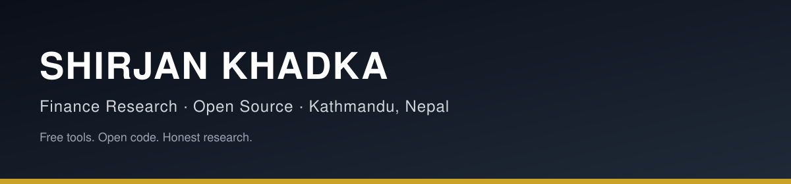

<!--
  GITHUB PROFILE README — PROFESSIONAL DESIGN v3, NOT A RESUME
  Publish: public repo named exactly ShirjanKhadka1, this file as README.md,
  with assets/ alongside it. No experience, no job history.
  Stats badges are dynamic, from real GitHub data. Nothing hard-coded.
-->

# Shirjan Khadka

**Finance Research · Open Source · Kathmandu, Nepal**

*Building free, open finance tools that anyone can run on their own machine —*
*no app, no subscription, no server, no data sent anywhere.*

---

## Projects

| Project | Focus | Status |
|---|---|---|
| **[Finance Research Agents](https://github.com/ShirjanKhadka1/finance-research-agents)** | 7 free, local AI research agents + runbooks | Ready to publish |
| **[Investment Analyst Toolkit](https://github.com/ShirjanKhadka1/investment-analyst-toolkit)** | Tested Python: ratios, DuPont, DCF, multiples — zero dependencies | 8/8 tests passing |
| **[Equity Research Playbook](https://github.com/ShirjanKhadka1/equity-research-playbook)** | Initiation, earnings, forensic, valuation-sanity templates | Ready to publish |
| **[Nepali Capital Market Research](https://github.com/ShirjanKhadka1/nepali-capital-market-research)** | Nepal's market structure: participants, instruments, regulation | Ready to publish |
| **[Nepali Business Opportunities](https://github.com/ShirjanKhadka1/nepali-business-opportunities)** | 8-sector opportunity scorecard, ranked by evidence | Ready to publish |
| **[Nepal Market Research](https://github.com/ShirjanKhadka1/nepal-market-research)** | Sourced NEPSE case studies, starting with Bottlers Nepal (Terai) | Inputs only |

> Project links go live when each repo is published. Until then, all of them
> are built locally and ready — nothing here claims a star, fork, or user
> count it does not have.

---

## Principles

| | |
|---|---|
| **Thesis first** | If it takes more than a paragraph, it's not ready. |
| **Every number sourced** | Source + period, on the same page as the number. |
| **Downside always** | A thesis with no way to be wrong is a pitch. |
| **Unfinished labelled** | Inputs-only studies are labelled inputs-only. |
| **Research only** | Never investment advice, never a buy/sell recommendation. |

---

## Focus

---

*Stats render from real GitHub data.*

---

🌐 [shirjankhadka.com.np](https://shirjankhadka.com.np/) · 💼 [LinkedIn](https://linkedin.com/in/shirjankhadkab) · 📍 Kathmandu, Nepal

