

<picture>
  <source media="(max-width: 600px) and (prefers-color-scheme: light)" srcset="assets/hero-mobile-light.svg">
  <source media="(max-width: 600px)" srcset="assets/hero-mobile-dark.svg">
  <source media="(prefers-color-scheme: light)" srcset="assets/hero-light.svg">
  
</picture>

**Finance Research · Open Source · Kathmandu, Nepal**

Free tools. Open code. Honest research.

[Portfolio](https://shirjankhadka.com.np) · [LinkedIn](https://www.linkedin.com/in/shirjankhadkab) · [GitHub](https://github.com/ShirjanKhadka1)

*Building free, open finance tools that anyone can run on their own machine — no app, no subscription, no server, no data sent anywhere.*

---

## Now Showing

<table>
<tr>
<td width="50%">
<a href="https://github.com/ShirjanKhadka1/finance-research-agents">
<picture><source media="(prefers-color-scheme: light)" srcset="assets/posters/poster-1-light.svg">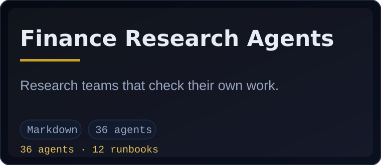</picture>
</a>
</td>
<td width="50%">
<a href="https://github.com/ShirjanKhadka1/investment-analyst-toolkit">
<picture><source media="(prefers-color-scheme: light)" srcset="assets/posters/poster-2-light.svg">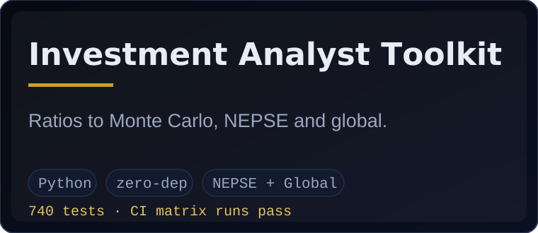</picture>
</a>
</td>
</tr>
<tr>
<td width="50%">
<a href="https://github.com/ShirjanKhadka1/equity-research-playbook">
<picture><source media="(prefers-color-scheme: light)" srcset="assets/posters/poster-3-light.svg">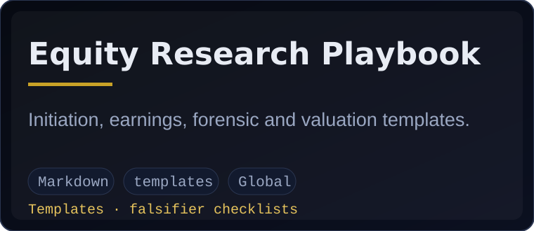</picture>
</a>
</td>
<td width="50%">
<a href="https://github.com/ShirjanKhadka1/nepali-capital-market-research">
<picture><source media="(prefers-color-scheme: light)" srcset="assets/posters/poster-4-light.svg">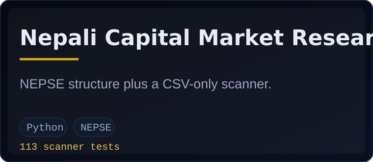</picture>
</a>
</td>
</tr>
<tr>
<td width="50%">
<a href="https://github.com/ShirjanKhadka1/nepal-market-research">
<picture><source media="(prefers-color-scheme: light)" srcset="assets/posters/poster-5-light.svg">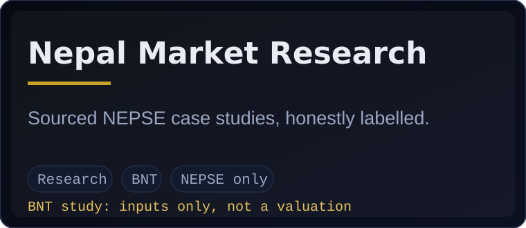</picture>
</a>
</td>
<td width="50%">
<a href="https://github.com/ShirjanKhadka1/nepali-business-opportunities">
<picture><source media="(prefers-color-scheme: light)" srcset="assets/posters/poster-6-light.svg">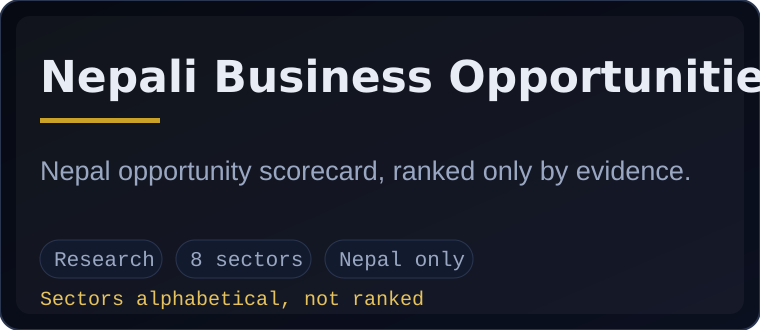</picture>
</a>
</td>
</tr>
<tr>
<td width="50%">
<a href="https://github.com/ShirjanKhadka1/financial-research-analyst-agent">
<picture><source media="(prefers-color-scheme: light)" srcset="assets/posters/poster-7-light.svg">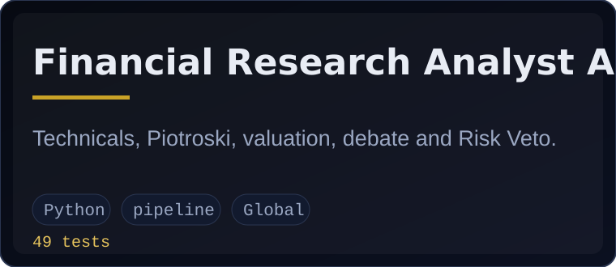</picture>
</a>
</td>
</tr>
</table>

---

## Capabilities

`Python` · `DCF` · `Valuation multiples` · `Monte Carlo` · `Options` · `Risk` · `Forecasting` · `Backtesting` · `NEPSE analytics` · `Research agents`

Every tag above is implemented in the repos linked above — DCF, multiples, options (Black–Scholes), Monte Carlo, risk (VaR/CVaR/drawdown), forecasting with walk-forward comparison, and backtesting all live in the Investment Analyst Toolkit; NEPSE analytics in the scanner; research agents in the agents pack.

---

## By the numbers

<picture>
  <source media="(prefers-color-scheme: light)" srcset="generated/numbers-light.svg">
  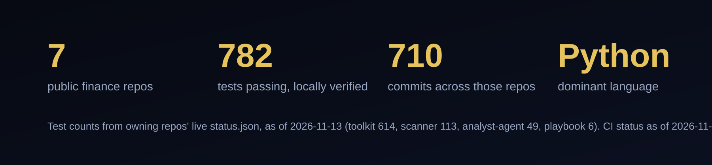
</picture>

<picture>
  <source media="(prefers-color-scheme: light)" srcset="generated/skyline-light.svg">
  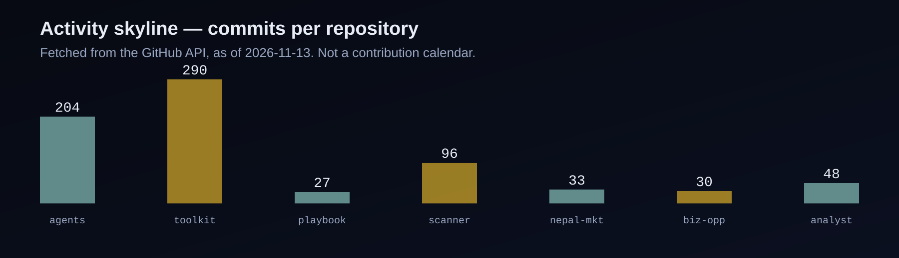
</picture>

Numbers are fetched from the public GitHub API (see `scripts/stats.json`, as of 13 Nov 2026) and test counts were verified locally on 13 Nov 2026 (generated counts in `status.json`, produced by `scripts/generate_status.py`, checked by `scripts/check_numbers.py`).

Note: the numbers graphic above was regenerated 13 Nov 2026 from `scripts/stats.json` with the verified totals (toolkit 614, scanner 113, analyst-agent 49, playbook 6). The SVG itself is not hand-edited. The skyline shows commits per repository — it is not a contribution calendar, because the full contribution calendar cannot be sourced cleanly with the available token scope.

### Status, honestly stated (13 Nov 2026 — test counts generated, see `status.json`)

| Repo | Tests (generated, 13 Nov 2026) | Latest CI Tests run |
|---|---|---|
| Investment Analyst Toolkit | 614/614 | Locally verified 13 Nov 2026 (pytest 614/614 in a fresh clone of main HEAD a60aff6); PRs #12, #16, #17, #18 merged 13 Nov 2026, each 26/26 checks green. |
| Finance Research Agents | 86/86 | Locally verified 13 Nov 2026 (86/86 in a fresh clone of main); the agents pack has no generated test-count status.json, so this row is fresh-clone evidence, not a generated count. |
| Nepali Capital Market Research (scanner) | 113/113 | CI Tests #94 green 8 Nov 2026; 113/113 per the repo's generated status.json. |
| Financial Research Analyst Agent | 49/49 | Locally verified 7 Nov 2026 (pytest 49/49 in a fresh clone); CI Tests #51 green 8 Nov 2026. |
| Equity Research Playbook | 6/6 | Locally verified 7 Nov 2026 (pytest 6/6 in a fresh clone); check-numbers green on the 29 Oct HEAD. |
| Other repos | Markdown/research, no test suite | — |

The 782 generated total in `status.json` covers toolkit + scanner + analyst-agent + playbook. The agents pack's 86 tests are verified separately by fresh-clone run (above) and are not part of the 782, because that repo publishes no generated test-count status.json.

No repo on this page is labelled "Live" on CI grounds alone. CodeQL runs for the code repos completed successfully (toolkit and scanner on 7 Nov 2026; analyst-agent on 29 Oct 2026).

---

## Principles

<picture>
  <source media="(prefers-color-scheme: light)" srcset="assets/principles-light.svg">
  
</picture>

---

### Credits

🌐 [shirjankhadka.com.np](https://shirjankhadka.com.np) · 💼 [LinkedIn](https://www.linkedin.com/in/shirjankhadkab) · 🐙 [GitHub](https://github.com/ShirjanKhadka1) · 📍 Kathmandu, Nepal

*Research and education only. Never investment advice, never a buy/sell recommendation, never guaranteed returns.*

*Profile generated 13 Nov 2026. Regenerate with `make verify` + `scripts/fetch_stats.py` + `scripts/generate.py` (see DESIGN.md).*

