

<picture>
  <source media="(max-width: 600px) and (prefers-color-scheme: light)" srcset="assets/hero-mobile-light.svg">
  <source media="(max-width: 600px)" srcset="assets/hero-mobile-dark.svg">
  <source media="(prefers-color-scheme: light)" srcset="assets/hero-light.svg">
  
</picture>

**Finance Research · Open Source · Kathmandu, Nepal**

Free tools. Open code. Honest research.

[Portfolio](https://shirjankhadka.com.np) · [LinkedIn](https://www.linkedin.com/in/shirjankhadkab) · [GitHub](https://github.com/ShirjanKhadka1)

*Building free, open finance tools that anyone can run on their own machine — no app, no subscription, no server, no data sent anywhere.*

---

## Now Showing

<table>
<tr>
<td width="50%">
<a href="https://github.com/ShirjanKhadka1/finance-research-agents">
<picture><source media="(prefers-color-scheme: light)" srcset="assets/posters/poster-1-light.svg">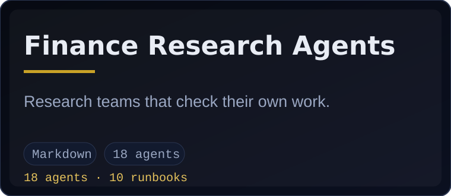</picture>
</a>
</td>
<td width="50%">
<a href="https://github.com/ShirjanKhadka1/investment-analyst-toolkit">
<picture><source media="(prefers-color-scheme: light)" srcset="assets/posters/poster-2-light.svg">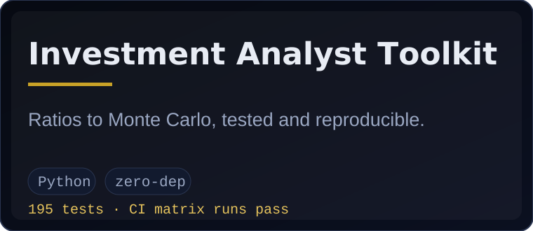</picture>
</a>
</td>
</tr>
<tr>
<td width="50%">
<a href="https://github.com/ShirjanKhadka1/equity-research-playbook">
<picture><source media="(prefers-color-scheme: light)" srcset="assets/posters/poster-3-light.svg">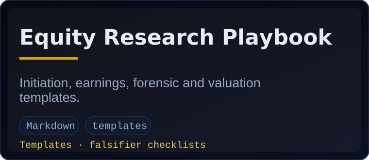</picture>
</a>
</td>
<td width="50%">
<a href="https://github.com/ShirjanKhadka1/nepali-capital-market-research">
<picture><source media="(prefers-color-scheme: light)" srcset="assets/posters/poster-4-light.svg">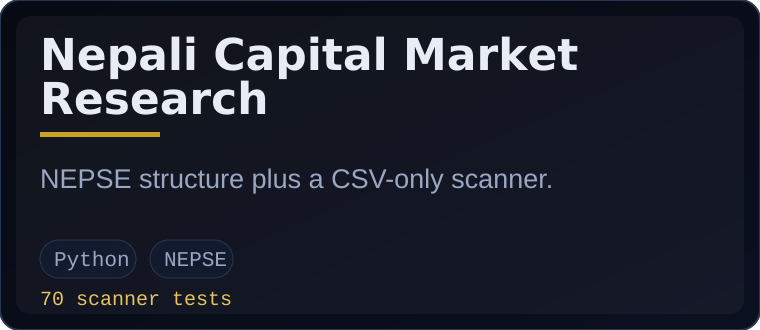</picture>
</a>
</td>
</tr>
<tr>
<td width="50%">
<a href="https://github.com/ShirjanKhadka1/nepal-market-research">
<picture><source media="(prefers-color-scheme: light)" srcset="assets/posters/poster-5-light.svg">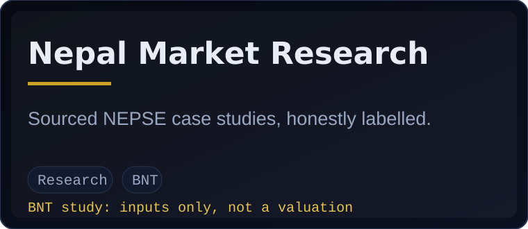</picture>
</a>
</td>
<td width="50%">
<a href="https://github.com/ShirjanKhadka1/nepali-business-opportunities">
<picture><source media="(prefers-color-scheme: light)" srcset="assets/posters/poster-6-light.svg">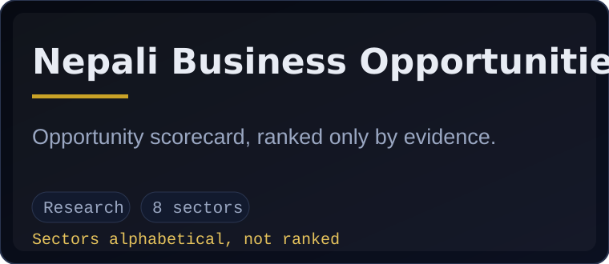</picture>
</a>
</td>
</tr>
<tr>
<td width="50%">
<a href="https://github.com/ShirjanKhadka1/financial-research-analyst-agent">
<picture><source media="(prefers-color-scheme: light)" srcset="assets/posters/poster-7-light.svg">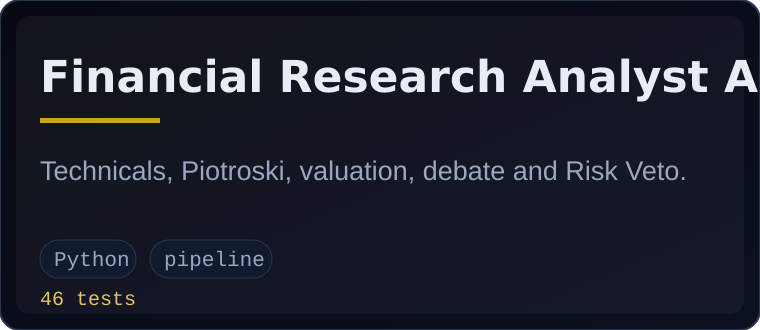</picture>
</a>
</td>
<td width="50%">
<a href="https://shirjankhadka.com.np/nepse-decode">
<picture><source media="(prefers-color-scheme: light)" srcset="assets/posters/poster-8-light.svg">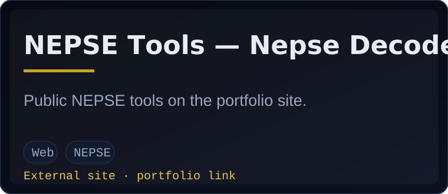</picture>
</a>
</td>
</tr>
</table>

> The NEPSE tools card links to the public portfolio website only. No private repository is linked or referenced anywhere on this page.

---

## Capabilities

`Python` · `DCF` · `Valuation multiples` · `Monte Carlo` · `Options` · `Risk` · `Forecasting` · `Backtesting` · `NEPSE analytics` · `Research agents`

Every tag above is implemented in the repos linked above — DCF, multiples, options (Black–Scholes), Monte Carlo, risk (VaR/CVaR/drawdown), forecasting with walk-forward comparison, and backtesting all live in the Investment Analyst Toolkit; NEPSE analytics in the scanner; research agents in the agents pack.

---

## By the numbers

<picture>
  <source media="(prefers-color-scheme: light)" srcset="generated/numbers-light.svg">
  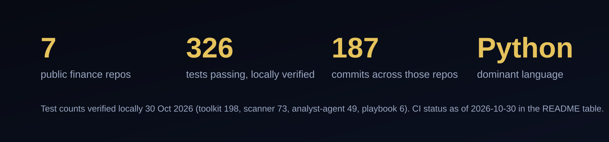
</picture>

<picture>
  <source media="(prefers-color-scheme: light)" srcset="generated/skyline-light.svg">
  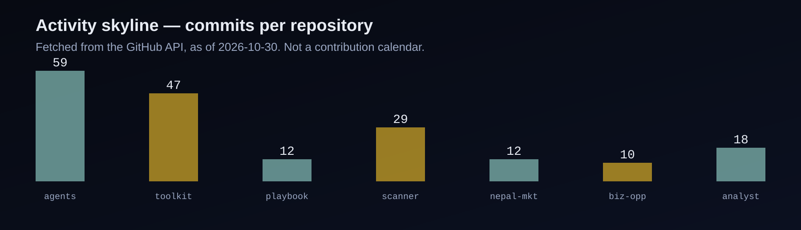
</picture>

Numbers are fetched from the public GitHub API (see `scripts/stats.json`, as of 29 Oct 2026) and test counts were verified locally on 28 Oct 2026. The skyline shows commits per repository — it is not a contribution calendar, because the full contribution calendar cannot be sourced cleanly with the available token scope.

### Status, honestly stated (29 Oct 2026)

| Repo | Tests (local, 28 Oct 2026) | Latest CI Tests run |
|---|---|---|
| Investment Analyst Toolkit | 129/129 | Matrix jobs pass (ubuntu/macOS/Windows); quality (ruff) job fails on `tests/test_phase9_ensemble.py` (RUF015). That fix belongs in the toolkit repo, not here. |
| Nepali Capital Market Research (scanner) | 57/57 | Matrix jobs pass (all 9, ubuntu/macOS/Windows); smoke passes; quality (ruff) job fails — same pattern as the toolkit. |
| Financial Research Analyst Agent | 46/46 | Matrix jobs pass (all 9, ubuntu/macOS/Windows); smoke passes; quality (ruff) job fails — same pattern as the toolkit. |
| Other repos | Markdown/research, no test suite | — |

No repo on this page is labelled "Live" on CI grounds alone. CodeQL runs for the code repos completed successfully on 28 Oct 2026.

---

## Principles

<picture>
  <source media="(prefers-color-scheme: light)" srcset="assets/principles-light.svg">
  
</picture>

---

### Credits

🌐 [shirjankhadka.com.np](https://shirjankhadka.com.np) · 💼 [LinkedIn](https://www.linkedin.com/in/shirjankhadkab) · 🐙 [GitHub](https://github.com/ShirjanKhadka1) · 📍 Kathmandu, Nepal

*Research and education only. Never investment advice, never a buy/sell recommendation, never guaranteed returns.*

*Profile generated 29 Oct 2026. Regenerate with `make verify` + `scripts/fetch_stats.py` + `scripts/generate.py` (see DESIGN.md).*

